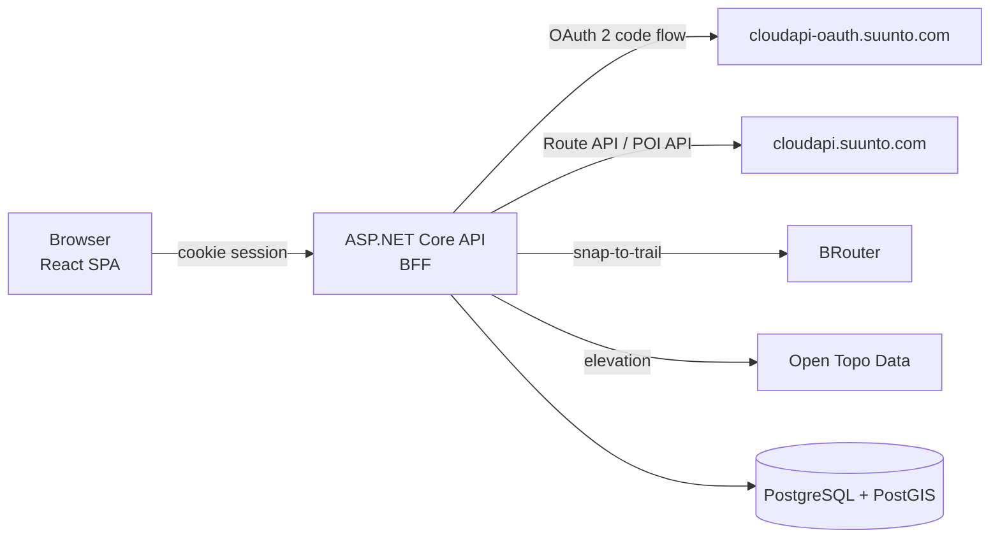

# Route & POI Manager for Suunto

Plan routes on OpenStreetMap, import GPX and FIT files, pin points of interest, and push both to your **Suunto app** account so they sync to your watch.

Routes go through Suunto's **Route API** and POIs through its **POI API**. The two are separate uploads with their own sync status. A POI that sits on a route also becomes a waypoint in that route, so the watch can alert you as you pass it.

> Independent project, not affiliated with or endorsed by Suunto. Using it requires your own access to the [Suunto API Zone](https://apizone.suunto.com) partner program.

---

## Features

**Library dashboard**
- Totals at a glance (routes, distance, climbing, POIs); "Not pushed" and "Needs attention" tiles double as filters
- **Boxes** (route outlines) or a sortable **List**, remembered per browser
- Search (ignores case and accents), filter by sync status or activity, sort by date, name, distance, ascent, POIs or status
- Select routes or POIs (Shift-click for a range) to **delete in bulk**, or **push selected POIs** to Suunto

**Route editor**
- OpenStreetMap base maps: OSM, OpenTopoMap and CyclOSM, with a dark and a light theme
- **Snap-to-trail** routing with [BRouter](https://brouter.de) (8 hiking and bike profiles) or **freehand** straight segments, chosen per segment
- Drag points to move them, drag the line to insert a point, right-click to delete
- Reverse, trim before or after a point, and split into two routes
- **Undo/redo** for every edit (`Ctrl+Z` / `Ctrl+Y`)
- **Elevation profile**, kept in sync with the map as you hover, plus distance, ascent and descent
- Autosave

**Import**
- **GPX** 1.0/1.1 tracks, routes and waypoints, including Suunto's own route-point extension
- **FIT** courses (with course points) and FIT activities (with laps)
- A preview with a live **simplification** slider and point count
- Waypoints and course points become POIs, with a suggested Suunto POI type you can change

**POIs**
- Place them on the map; a click near the route snaps onto it
- All 61 Suunto POI types, with category icons
- Shown in route order and on the elevation profile
- An **All POIs** page that includes standalone POIs pulled from Suunto

**Suunto sync**
- Sign in with your Suunto account (OAuth 2). The app never sees your password.
- Push routes (create, or update on the current revision) and POIs (create or update), with a result for each POI and a Retry for failures
- **Conflict handling:** if a route changed in the Suunto app since your last sync, you choose *keep mine*, *take theirs* or *save mine as a copy*. Nothing is overwritten silently.
- **Refresh from Suunto** pulls routes and POIs created in the app, without duplicating ones you already have
- GPX download of any route, with all its POIs

**Quality**
- Accessible: keyboard support, a skip link and reduced motion; automated axe scans find no WCAG A/AA violations in either theme
- Unit, integration and Playwright end-to-end tests

---

## How it works



- **Backend for frontend:** the API runs the OAuth flow and keeps Suunto tokens encrypted at rest, using ASP.NET Data Protection with its keys in the database. The browser only holds an HttpOnly session cookie and never sees a Suunto token.
- **Local first:** routes and POIs live in your database, and nothing goes to Suunto until you press **Push**. Suunto forbids polling, so syncing *from* Suunto happens only when you click **Refresh from Suunto**.
- **POIs and route waypoints:** each POI is pushed as a standalone Suunto POI. When it lies within 200 m of the route line, it's also written into the route's GPX as a `suunto:routePoint` at its spot on the line.
- **Deleting:** Suunto's APIs have no delete, so deleting a route or POI here removes it only locally. The app tells you, and you remove it in the Suunto app if you want it gone there too.

---

## Getting started

### Prerequisites

- [Docker Desktop](https://www.docker.com/products/docker-desktop/)
- Suunto partner access: a **Developer API subscription key**, plus an **OAuth client id and secret** from your [API Zone](https://apizone.suunto.com) profile

For development you also need the [.NET SDK 10](https://dotnet.microsoft.com) and [Node.js 24](https://nodejs.org).

### 1. Register the app with Suunto

In your API Zone profile, under OAuth settings:
- set an app name and a client secret
- set the **redirect URI** to exactly:

```
http://localhost:5080/auth/callback
```

### 2. Add your credentials

```bash
cp .env.example .env
```

Fill in `SUUNTO_CLIENT_ID`, `SUUNTO_CLIENT_SECRET` and `SUUNTO_SUBSCRIPTION_KEY`. `.env` is git-ignored; never commit it. The API refuses to start if one of them is missing, and the log names which.

### 3. Run

```bash
docker compose up --build -d
```

Open **http://localhost:5080** and choose **Sign in with Suunto**.

| Service | Address |
|---|---|
| App (API + web UI) | http://localhost:5080 |
| PostgreSQL / PostGIS | `localhost:5432` (`routepoi` / `routepoi`) |

---

## Configuration

Set these in `.env` for Docker Compose:

| Variable | Required | Description |
|---|---|---|
| `SUUNTO_CLIENT_ID` | ✔ | OAuth client id from the API Zone |
| `SUUNTO_CLIENT_SECRET` | ✔ | OAuth client secret you set in the API Zone |
| `SUUNTO_SUBSCRIPTION_KEY` | ✔ | Developer API subscription key (`Ocp-Apim-Subscription-Key`) |
| `SUUNTO_DIAGNOSTICS` | | `true` logs the shape of Suunto responses (never tokens or keys); for troubleshooting |
| `REQUIRE_OAUTH_STATE` | | Default `true`: OAuth callbacks must carry the matching `state` |
| `POSTGRES_PASSWORD` | | Database password; only takes effect before the database volume is first created |

Other API settings (environment variables use `__` for nesting, e.g. `Routing__BaseUrl`):

| Setting | Default | Description |
|---|---|---|
| `Routing:BaseUrl` | `https://brouter.de/brouter` | BRouter endpoint. The public server is fair-use; point this at your own BRouter for heavy use. |
| `Routing:MaxSnapDistanceM` | `300` | A click further than this from any trail falls back to a straight segment |
| `Elevation:Provider` | `OpenTopoData` | `None` disables elevation lookups (no external calls) |
| `Elevation:Dataset` | `mapzen` | [Open Topo Data](https://www.opentopodata.org) dataset; `mapzen` is global |

---

## Development

Run the database in Docker, and the API and web app locally with hot reload:

```bash
docker compose up -d db
```

```bash
dotnet run --project src/RoutePoiManager.Api
```

```bash
npm --prefix src/web install
```

```bash
npm --prefix src/web run dev
```

Then open http://localhost:5173. For `dotnet run`, put the Suunto settings in `src/RoutePoiManager.Api/appsettings.Local.json` (git-ignored):

```json
{ "Suunto": { "ClientId": "…", "ClientSecret": "…", "SubscriptionKey": "…" } }
```

Vite proxies `/api` and `/auth` to the API on port 5080. Suunto still redirects to the registered `http://localhost:5080/auth/callback`; the session cookie works on both ports, and the API then sends you on to 5173. Don't run the `api` compose service at the same time; it uses port 5080.

---

## Testing

Automated tests **never touch a real Suunto account**. They use **MockSuunto** (`src/RoutePoiManager.MockSuunto`), an in-memory stand-in that follows Suunto's documented OAuth, Route and POI contracts and reproduces the live API's undocumented behaviour (see below).

```bash
dotnet test
```

```bash
npm --prefix src/web test
```

- **.NET unit tests:** geometry, GPX/FIT parsing, simplification, GPX building, the sync rules
- **.NET integration tests:** the API against a throwaway PostGIS (Testcontainers; Docker must be running) and MockSuunto, covering sign-in, route and POI CRUD, import, push, conflicts and refresh
- **Web unit tests:** editor store and undo, geometry, dialogs and components (Vitest)

### End-to-end tests (Playwright)

A real browser against the full stack running MockSuunto: sign-in, drawing, dragging and undo, reverse, POIs, push, import, and axe accessibility scans in both themes.

```bash
docker compose -f docker-compose.yml -f docker-compose.e2e.yml up --build -d
```

```bash
npx --prefix src/web playwright install chromium
```

```bash
npm --prefix src/web run e2e
```

Switch back to the real Suunto afterwards:

```bash
docker compose up -d --remove-orphans
```

---

## Project structure

```
src/
  RoutePoiManager.Api             ASP.NET Core host: OAuth (BFF cookie session), REST endpoints, serves the web app
  RoutePoiManager.Domain          entities, geometry, route drawing, Suunto POI types and activity ids
  RoutePoiManager.Infrastructure  EF Core + PostGIS, Suunto clients, sync, GPX/FIT import, routing, elevation
  RoutePoiManager.MockSuunto      test double of the Suunto cloud (tests and e2e only)
  web/                            React + Vite web app (unit tests next to the code, Playwright in e2e/)
tests/
  RoutePoiManager.UnitTests
  RoutePoiManager.IntegrationTests
PLAN.md                           design decisions, data model and implementation notes
```

**Stack:**
- Backend: .NET 10, ASP.NET Core minimal APIs, EF Core with Npgsql and NetTopologySuite, Garmin FIT SDK, Polly resilience, Serilog
- Frontend: React 19, TypeScript, Vite, Leaflet / react-leaflet, TanStack Query, Zustand + zundo
- Database: PostgreSQL 17 with PostGIS
- Tests: xUnit, Testcontainers, Vitest, Testing Library, Playwright, axe-core

---

## Suunto API notes

Things learned against the live API that the documentation doesn't spell out. They may save you time if you build on it too.

- **Hosts:** OAuth is on `cloudapi-oauth.suunto.com`; the Route and POI APIs are on `cloudapi.suunto.com`, and every call there needs both `Authorization: Bearer …` and `Ocp-Apim-Subscription-Key`.
- **Tokens** last 24 hours (`expires_in` 86399) with `scope` `workout`, and come with a refresh token. An `http://localhost` redirect URI is accepted, and the OAuth `state` is passed back.
- **Route import** (`POST /v2/route/import`) answers `{"items":[{"id": …, "username": …, "description": …, …}]}`.
- **Route update** (`PUT /v2/route/{id}`) needs the GPX from `GET …/export` carrying `suunto:id` and the *current* `suunto:revision`; a stale revision gets `409`.
- **POI timestamps** (`creation`, `modified`) must be **epoch milliseconds**, although the documentation example looks like seconds. Seconds get **HTTP 200** with `"errorCode": 4` and an empty `key`, and **no POI is created**. Always check `errorCode` and `key`, not just the status code. `country`/`locality` are optional.
- **Coordinates** in the POI API are `x` = longitude, `y` = latitude.
- **No delete** endpoint exists for routes or POIs.
- **Polling is prohibited:** fetch only on user action, or use webhooks with a public URL.

---

## Limitations

- **Partner access:** Suunto grants API access to companies and organisations; personal use may not be approved.
- **Single machine:** the app is built to run locally for one person, with no hosting or multi-tenant hardening.
- **Webhooks:** Suunto change notifications need a public URL, so changes in the Suunto app arrive only when you press **Refresh from Suunto**.
- **Public services:** BRouter (routing), Open Topo Data (elevation: 1 request per second, 1,000 per day) and the OSM tile servers are free, fair-use services. Respect their usage policies, or self-host for heavy use.
- **Watch limits:** Suunto doesn't document the maximum number of route points a watch accepts, or how long names can be. Routes are simplified slightly before pushing (2 m tolerance).

---

## Contributing

Issues and pull requests are welcome. Please run `dotnet test` and `npm --prefix src/web test` before opening a PR, and add tests for behaviour changes. [PLAN.md](PLAN.md) explains the design decisions behind the code.

## License

No license has been chosen yet. Until one is added, all rights are reserved by the author.

## Acknowledgements

Map data © [OpenStreetMap](https://www.openstreetmap.org/copyright) contributors · Map styles by [OpenTopoMap](https://opentopomap.org) and [CyclOSM](https://www.cyclosm.org) · Routing by [BRouter](https://brouter.de) · Elevation by [Open Topo Data](https://www.opentopodata.org) · FIT parsing with the [Garmin FIT SDK](https://developer.garmin.com/fit/)
