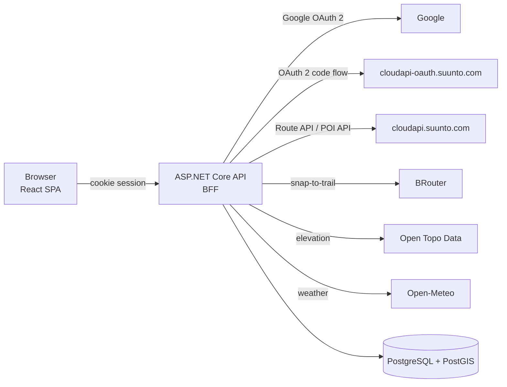

# Atrapos

*Routes and POIs for your Suunto watch.* The name comes from the Greek *atrapos* (ἀτραπός), a footpath or track.

Plan routes on OpenStreetMap, import GPX and FIT files, pin points of interest, and push both to your **Suunto app** account so they sync to your watch.

Routes go through Suunto's **Route API** and POIs through its **POI API**. The two are separate uploads with their own sync status. A POI that sits on a route also becomes a waypoint in that route, so the watch can alert you as you pass it.

> Atrapos works with Suunto but is not affiliated with or endorsed by Suunto. Suunto is a trademark of its owner. Using it requires your own access to the [Suunto API Zone](https://apizone.suunto.com) partner program.

---

## Features

**Library dashboard**
- Totals at a glance (routes, distance, climbing, POIs); "Not pushed" and "Needs attention" tiles double as filters
- **Boxes** (route outlines), a sortable **List** or a **Map** showing all your routes at once, remembered per browser
- Search (ignores case and accents), filter by sync status or activity, sort by date, name, distance, ascent, POIs or status
- Select routes or POIs (Shift-click for a range) to **delete in bulk**, or **push selected POIs** to Suunto

**Route editor**
- OpenStreetMap base maps: OSM, OpenTopoMap and CyclOSM, with a dark and a light theme
- **Place search** on the map (OpenStreetMap Nominatim) to jump to a town, peak or address
- **Snap-to-trail** routing with [BRouter](https://brouter.de) (8 hiking and bike profiles) or **freehand** straight segments, chosen per segment; profile suggestions follow the selected sport, with cycling prioritized
- Drag points to move them, drag the line to insert a point, right-click to delete
- Reverse, trim before or after a point, and split a saved route into new routes at a chosen distance without changing the original
- **Undo/redo** for every edit (`Ctrl+Z` / `Ctrl+Y`)
- **Elevation profile**, kept in sync with the map as you hover, plus distance, ascent and descent (ascent and descent ignore small DEM noise, so totals aren't inflated)
- **Section analysis:** drag across the elevation profile (then drag the handles to adjust), or pick the **ruler** tool and click two points on the route or two of its markers, to measure just that part: distance, ascent, descent, net change, average and steepest grades, highest and lowest point, and the POIs in it. The section is highlighted on the map and **Zoom to section** fits it. `Esc` clears it.
- **7-day weather forecast** along a saved route, with daily summaries and expandable three-hour forecasts in the route’s local time
- Routes are saved only when you press **Save**. Leaving with unsaved changes asks whether to save them or discard them.
- New routes are added to the library only after you place at least one map point and save.

**Import**
- **GPX** 1.0/1.1 tracks, routes and waypoints, including Suunto's own route-point extension
- **FIT** courses (with course points) and FIT activities (with laps)
- A preview with a live **simplification** slider and point count
- Waypoints and course points become POIs, with a suggested Suunto POI type you can change

**GPX tools**
- Merge multiple GPX tracks or routes into one ordered route and create it in the app
- Split a GPX track or route manually on the map or at a chosen distance; download the parts or create a route for each part
- **Shrink** a GPX or FIT file to reduce its size and point count, then download it
- Convert a GPX file to FIT or a FIT file to GPX and download the converted file; the first track is converted point for point, with elevation, recorded times and waypoints preserved where supported (GPX→FIT produces a FIT course with lap, timer events and course points placed along the track)

**POIs**
- Place them on the map; a click near the route snaps onto it
- All 61 Suunto POI types, with category icons
- Shown in route order and on the elevation profile
- An **All POIs** page, as a list or on a map, that includes standalone POIs pulled from Suunto

**Account sign-in**
- Sign in with Google for an app account, or sign in with Suunto to use your existing Suunto-backed account
- From a Google account, choose **Connect Suunto** in the account menu to associate your Suunto account; existing Suunto routes and POIs are merged into the Google account, keeping the Suunto account's copy if a route or POI is already present
- **Disconnect Suunto** revokes this app's access while keeping you signed in with Google; a Suunto-only account is signed out when disconnected

**Admin UI** (opt-in, for whoever runs the instance)
- Browse, edit and delete every user, route, POI (including soft-deleted ones), source file, sync log entry and error log entry, with search, filters and paging
- **Statistics** for any date range: new users, routes, POIs, imports, Suunto pushes and errors per day, week or month
- Edit the sign-in allowlists live, and see the effective configuration (secrets are never shown)
- Enabled by listing yourself in `ADMIN_GOOGLE_EMAILS` or `ADMIN_SUUNTO_USERNAMES`; an **Admin** link then appears in the top bar

**Profile and preferences**
- A profile page shows your connected accounts and lets you set a **default map**, **units** (metric or imperial) and **appearance** (dark or light). Preferences are saved to your account (`/api/settings`), so they follow you across browsers.
- Choose a **design**: *Classic* (the original dark glass look), *Alpine* (light and editorial, with serif headings) or *Soft* (warm and rounded). Each works in both dark and light appearance, and the choice is saved to your account like the other preferences.
- Choose a **menu position**: an icon rail on the left (the default) or a menu in the top bar. Every design uses the same menu; phones always get a bottom tab bar.
- Choose **favorite sports** to show as alphabetical quick-checkbox options in route planning; other sports remain available in the activity list.
- Set an optional **default routing profile** for new routes. Leave it blank to suggest a profile based on the selected sport, prioritizing cycling when multiple sport types are selected.

**Suunto sync**
- Sign in with your Suunto account (OAuth 2). The app never sees your password.
- Push routes (create, or update on the current revision) and POIs (create or update), with a result for each POI and a Retry for failures
- **Conflict handling:** if a route changed in the Suunto app since your last sync, you choose *keep mine*, *take theirs* or *save mine as a copy*. Nothing is overwritten silently.
- **Refresh from Suunto** pulls routes and POIs created in the app, without duplicating ones you already have. Route waypoints stay part of the route; a waypoint is associated as a POI only when it matches a POI returned separately by Suunto's POI API. GPX imports still keep explicitly defined POIs
- GPX download of any route, with all its POIs

**Quality**
- Responsive: on phones the main navigation becomes a bottom tab bar under a slim top bar, and the library actions stack for thumb reach
- Accessible: keyboard support, a skip link and reduced motion; automated axe scans find no WCAG A/AA violations in either theme
- Unit, integration and Playwright end-to-end tests

---

## How it works



- **Backend for frontend:** the API runs the OAuth flow and keeps Suunto tokens encrypted at rest, using ASP.NET Data Protection with its keys in the database. The browser only holds an HttpOnly session cookie and never sees a Suunto token.
- **Local first:** routes and POIs live in your database, and nothing goes to Suunto until you press **Push**. Suunto forbids polling, so syncing *from* Suunto happens only when you click **Refresh from Suunto**.
- **Weather:** daily summaries and three-hour forecasts are requested from Open-Meteo only when opened, cached for 30 minutes, and aggregated from the start, midpoint and end of the saved route. Three-hour times use the route midpoint’s local time zone. Free API use is limited to non-commercial projects; commercial deployments need an Open-Meteo API subscription. Forecasts are estimates and are attributed in the app under CC BY 4.0.
- **POIs and route waypoints:** each POI is pushed as a standalone Suunto POI. When it lies within 200 m of the route line, it's also written into the route's GPX as a `suunto:routePoint` at its spot on the line.
- **Deleting:** Suunto's APIs have no delete, so deleting a route or POI here removes it only locally. A deleted route that's still on Suunto can return on the next refresh. The app tells you, and you remove it in the Suunto app if you want it gone there too.

---

## Getting started

### Prerequisites

- [Docker Desktop](https://www.docker.com/products/docker-desktop/)
- Suunto partner access: a **Developer API subscription key**, plus an **OAuth client id and secret** from your [API Zone](https://apizone.suunto.com) profile

For development you also need the [.NET SDK 10](https://dotnet.microsoft.com) and [Node.js 24](https://nodejs.org).

### 1. Register the app with Suunto

In your API Zone profile, under OAuth settings:
- set an app name and a client secret
- set the **redirect URI** to exactly:

```
http://localhost:5080/auth/callback
```

### 2. Add your credentials

```bash
cp .env.example .env
```

Fill in `SUUNTO_CLIENT_ID`, `SUUNTO_CLIENT_SECRET` and `SUUNTO_SUBSCRIPTION_KEY`. To enable Google sign-in, also create a Google OAuth web client with redirect URI `http://localhost:5080/auth/google-callback` and set `GOOGLE_CLIENT_ID` and `GOOGLE_CLIENT_SECRET`. Google sign-in is optional; without these values, Suunto sign-in continues to work. Any Google or Suunto account can sign in and gets its own private data; to restrict that, list accounts in `ALLOWED_GOOGLE_EMAILS` and/or `ALLOWED_SUUNTO_USERNAMES`. `.env` is git-ignored; never commit it. The API refuses to start if a required Suunto credential is missing, and the log names which.

### 3. Run

```bash
docker compose up --build -d
```

Open **http://localhost:5080** and choose Google or Suunto sign-in. A Google account can later be associated with Suunto from the account menu; existing Suunto account data is merged into the Google account.

| Service | Address |
|---|---|
| App (API + web UI) | http://localhost:5080 |
| PostgreSQL / PostGIS | `localhost:5432` (`routepoi` / `routepoi`) |

---

## Configuration

Set these in `.env` for Docker Compose:

| Variable | Required | Description |
|---|---|---|
| `SUUNTO_CLIENT_ID` | ✔ | OAuth client id from the API Zone |
| `SUUNTO_CLIENT_SECRET` | ✔ | OAuth client secret you set in the API Zone |
| `SUUNTO_SUBSCRIPTION_KEY` | ✔ | Developer API subscription key (`Ocp-Apim-Subscription-Key`) |
| `GOOGLE_CLIENT_ID` | | Google OAuth web client id; enables Google app sign-in |
| `GOOGLE_CLIENT_SECRET` | | Google OAuth web client secret |
| `ALLOWED_GOOGLE_EMAILS` | | Optional¹: comma-separated verified Google emails allowed to sign in with Google |
| `ALLOWED_SUUNTO_USERNAMES` | | Optional¹: comma-separated Suunto usernames allowed to sign in with Suunto (a Google account connecting Suunto needs no entry) |
| `ADMIN_GOOGLE_EMAILS` | | Optional: comma-separated verified Google emails that may open the [admin UI](docs/technical.md#16-admin-ui) at `/admin` |
| `ADMIN_SUUNTO_USERNAMES` | | Optional: comma-separated Suunto usernames that may open the admin UI. Both empty (default): nobody is an admin |
| `SUUNTO_DIAGNOSTICS` | | `true` logs the shape of Suunto responses (never tokens or keys); for troubleshooting |
| `REQUIRE_OAUTH_STATE` | | Default `true`: OAuth callbacks must carry the matching `state` |
| `POSTGRES_PASSWORD` | | Database password; only takes effect before the database volume is first created |
| `MAX_UPLOAD_MB` | | Default `20`: largest GPX or FIT file accepted, in MB (sets `Uploads:MaxFileSizeMb`) |
| `FORWARDED_HEADERS` | | Default `false`: set `true` behind a TLS reverse proxy so the client address and `https` scheme are trusted (`Hosting:ForwardedHeaders`) |
| `TRUSTED_PROXIES` | | Comma-separated proxy IPs to trust for forwarded headers; empty trusts any sender, so only use that when the proxy is the sole way in |
| `HSTS` | | Default `false`: set `true` once the site is served over https to send `Strict-Transport-Security` |

¹ Both empty (the default): any Google or Suunto account can sign in. Once either is set, everyone else is refused at sign-in, and sessions of accounts taken off a list end within `Auth:SessionRevalidationInterval` (default 5 minutes).

Other API settings (environment variables use `__` for nesting, e.g. `Routing__BaseUrl`):

| Setting | Default | Description |
|---|---|---|
| `Routing:BaseUrl` | `https://brouter.de/brouter` | BRouter endpoint. The public server is fair-use; point this at your own BRouter for heavy use. |
| `Routing:MaxSnapDistanceM` | `300` | A click further than this from any trail falls back to a straight segment |
| `Elevation:Provider` | `OpenTopoData` | `None` disables elevation lookups (no external calls) |
| `Elevation:Dataset` | `mapzen` | [Open Topo Data](https://www.opentopodata.org) dataset; `mapzen` is global |
| `Auth:SessionLifetime` | `60.00:00:00` | How long a sign-in lasts (`days.hh:mm:ss`). Sliding: using the app renews it. |
| `Auth:SessionRevalidationInterval` | `00:05:00` | How often a session is re-checked against the database and the allowlists |
| `Uploads:MaxFileSizeMb` | `20` | Largest GPX or FIT file accepted for import and the GPX tools, 1–500 MB. Each file is held in memory while it's read, so raise it with the API's memory in mind. The web app picks the value up from the API. |
| `Hosting:ContentSecurityPolicy` | built-in policy | Content-Security-Policy for the web app (allows the map tile hosts, Google Fonts and Nominatim); empty turns it off. Not sent on `/auth`, Swagger or OpenAPI pages. |
| `Hosting:RateLimit:Enabled` | `true` | Per-minute request limits, per signed-in user (per address when signed out) |
| `Hosting:RateLimit:PerMinute` | `600` | All endpoints, per user |
| `Hosting:RateLimit:ExternalPerMinute` | `120` | Routing, elevation and weather, which call public services on the user's behalf |
| `Hosting:RateLimit:AuthPerMinute` | `30` | Sign-in endpoints (`/auth`), per client address. Over the limit: `429` with `Retry-After`. |

---

## Hosting for other people

The defaults suit one machine. To serve others over the internet:

1. Put a TLS-terminating reverse proxy (Caddy, nginx, Traefik) in front, pass `Host`, `X-Forwarded-For` and `X-Forwarded-Proto`, and make the proxy the only way to reach the app (for Compose, change the port mapping to an internal network).
2. Set `App__PublicBaseUrl` and `Suunto__RedirectUri` to your public https URLs, and update the redirect URI in the Suunto API Zone and the Google client (`https://your-host/auth/google-callback`).
3. Set `FORWARDED_HEADERS=true` (and `TRUSTED_PROXIES` to the proxy's IP where you can), so sessions get `Secure` cookies and rate limits count the real client address. Without it behind a proxy, every user shares the proxy's address and its limit.
4. Set `HSTS=true` once https works, and redirect http to https at the proxy.
5. Consider `ALLOWED_GOOGLE_EMAILS` / `ALLOWED_SUUNTO_USERNAMES`, and self-hosting BRouter and Open Topo Data (see Limitations), since all users share their fair-use quotas.
6. Review the footer and the **Privacy and terms** (`/privacy`) and **Cookies** (`/cookies`) pages. They name this project's developer as the operator: change `src/web/src/lib/site.ts` and `src/web/src/features/legal/` to name yours, and point `sourceUrl` at your fork if you changed the code (AGPL section 13).

The built-in rate limits are in memory and per API instance (see `Hosting:RateLimit:*`).

---

## Development

Run the database in Docker, and the API and web app locally with hot reload:

```bash
docker compose up -d db
```

```bash
dotnet run --project src/RoutePoiManager.Api
```

```bash
npm --prefix src/web install
```

```bash
npm --prefix src/web run dev
```

Then open http://localhost:5173. For `dotnet run`, put the Suunto and Google settings (and the optional allowlist) in `src/RoutePoiManager.Api/appsettings.Local.json` (git-ignored). Start from the template and fill in the empty values:

```bash
cp src/RoutePoiManager.Api/appsettings.Local.json.example src/RoutePoiManager.Api/appsettings.Local.json
```

Vite proxies `/api` and `/auth` to the API on port 5080. Suunto still redirects to the registered `http://localhost:5080/auth/callback`; the session cookie works on both ports, and the API then sends you on to 5173. Don't run the `api` compose service at the same time; it uses port 5080.

---

## Testing

Automated tests **never touch a real Suunto account**. They use **MockSuunto** (`src/RoutePoiManager.MockSuunto`), an in-memory stand-in that follows Suunto's documented OAuth, Route and POI contracts and reproduces the live API's undocumented behaviour (see below).

```bash
dotnet test
```

```bash
npm --prefix src/web test
```

- **.NET unit tests:** geometry, GPX/FIT parsing, simplification, GPX building, the sync rules
- **.NET integration tests:** the API against a throwaway PostGIS (Testcontainers; Docker must be running) and MockSuunto, covering sign-in, route and POI CRUD, import, push, conflicts and refresh
- **Web unit tests:** editor store and undo, geometry, dialogs and components (Vitest)

### End-to-end tests (Playwright)

A real browser against the full stack running MockSuunto: sign-in, drawing, dragging and undo, reverse, POIs, push, import, and axe accessibility scans in both themes.

```bash
docker compose -f docker-compose.yml -f docker-compose.e2e.yml up --build -d
```

```bash
npx --prefix src/web playwright install chromium
```

```bash
npm --prefix src/web run e2e
```

Switch back to the real Suunto afterwards:

```bash
docker compose up -d --remove-orphans
```

---

## Project structure

```
src/
  RoutePoiManager.Api             ASP.NET Core host: OAuth (BFF cookie session), REST endpoints, serves the web app
  RoutePoiManager.Domain          entities, geometry, route drawing, Suunto POI types and activity ids
  RoutePoiManager.Infrastructure  EF Core + PostGIS, Suunto clients, sync, GPX/FIT import, routing, elevation
  RoutePoiManager.MockSuunto      test double of the Suunto cloud (tests and e2e only)
  web/                            React + Vite web app (unit tests next to the code, Playwright in e2e/)
tests/
  RoutePoiManager.UnitTests
  RoutePoiManager.IntegrationTests
PLAN.md                           design decisions, data model and implementation notes
```

**Stack:**
- Backend: .NET 10, ASP.NET Core minimal APIs, EF Core with Npgsql and NetTopologySuite, a built-in FIT reader/writer, Polly resilience, Serilog
- Frontend: React 19, TypeScript, Vite, Leaflet, TanStack Query, Zustand + zundo
- Database: PostgreSQL 17 with PostGIS
- Tests: xUnit, Testcontainers, Vitest, Testing Library, Playwright, axe-core

---

## Suunto API notes

Things learned against the live API that the documentation doesn't spell out. They may save you time if you build on it too.

- **Hosts:** OAuth is on `cloudapi-oauth.suunto.com`; the Route and POI APIs are on `cloudapi.suunto.com`, and every call there needs both `Authorization: Bearer …` and `Ocp-Apim-Subscription-Key`.
- **Tokens** last 24 hours (`expires_in` 86399) with `scope` `workout`, and come with a refresh token. An `http://localhost` redirect URI is accepted, and the OAuth `state` is passed back.
- **Route import** (`POST /v2/route/import`) answers `{"items":[{"id": …, "username": …, "description": …, …}]}`.
- **Route update** (`PUT /v2/route/{id}`) needs the GPX from `GET …/export` carrying `suunto:id` and the *current* `suunto:revision`; a stale revision gets `409`.
- **POI timestamps** (`creation`, `modified`) must be **epoch milliseconds**, although the documentation example looks like seconds. Seconds get **HTTP 200** with `"errorCode": 4` and an empty `key`, and **no POI is created**. Always check `errorCode` and `key`, not just the status code. `country`/`locality` are optional.
- **Coordinates** in the POI API are `x` = longitude, `y` = latitude.
- **No delete** endpoint exists for routes or POIs.
- **Polling is prohibited:** fetch only on user action, or use webhooks with a public URL.

---

## Limitations

- **Partner access:** Suunto grants API access to companies and organisations; personal use may not be approved.
- **Multi-user, TLS is up to you:** any number of Google or Suunto accounts can sign in, and every API call only sees that user's data (restrict who may sign in with the allowlists). The app sends security headers and rate-limits requests, and can trust a reverse proxy's forwarded headers and send HSTS, but it doesn't terminate TLS or redirect to https itself. Docker Compose publishes it on `127.0.0.1:5080` only and the redirect URIs default to `http://localhost:5080`. See [Hosting for other people](#hosting-for-other-people).
- **Single instance:** routing and elevation caches and the shared rate limits for BRouter and Open Topo Data live in the API process's memory (as do the built-in request limits), so running several API replicas multiplies the load on those public services.
- **Webhooks:** Suunto change notifications need a public URL, so changes in the Suunto app arrive only when you press **Refresh from Suunto**.
- **Public services:** BRouter (routing), Open Topo Data (elevation: 1 request per second, 1,000 per day), the OSM tile servers and Nominatim (place search, called from the browser) are free, fair-use services. Respect their usage policies, or self-host for heavy use.
- **Watch limits:** Suunto doesn't document the maximum number of route points a watch accepts, or how long names can be. Routes are simplified slightly before pushing (2 m tolerance).

---

## Contributing

Issues and pull requests are welcome. Please run `dotnet test` and `npm --prefix src/web test` before opening a PR, and add tests for behaviour changes. [PLAN.md](PLAN.md) explains the design decisions behind the code.

## License

Copyright © 2026 Panagiotis Kritikakos

Atrapos is free software: you can redistribute it and/or modify it under the terms of the [GNU Affero General Public License](LICENSE) as published by the Free Software Foundation, either version 3 of the License, or (at your option) any later version. It is distributed in the hope that it will be useful, but WITHOUT ANY WARRANTY; without even the implied warranty of MERCHANTABILITY or FITNESS FOR A PARTICULAR PURPOSE. See [LICENSE](LICENSE) for the full text.

If you run a modified version on a server that other people use, the AGPL requires you to offer those users the source code of your version (section 13).

Third-party libraries, map data and services keep their own licenses and terms.

## Acknowledgements

Map data © [OpenStreetMap](https://www.openstreetmap.org/copyright) contributors · Map styles by [OpenTopoMap](https://opentopomap.org) and [CyclOSM](https://www.cyclosm.org) · Routing by [BRouter](https://brouter.de) · Elevation by [Open Topo Data](https://www.opentopodata.org) · FIT profile tables checked against [muktihari/fit](https://github.com/muktihari/fit) and [python-fitparse](https://github.com/dtcooper/python-fitparse)
