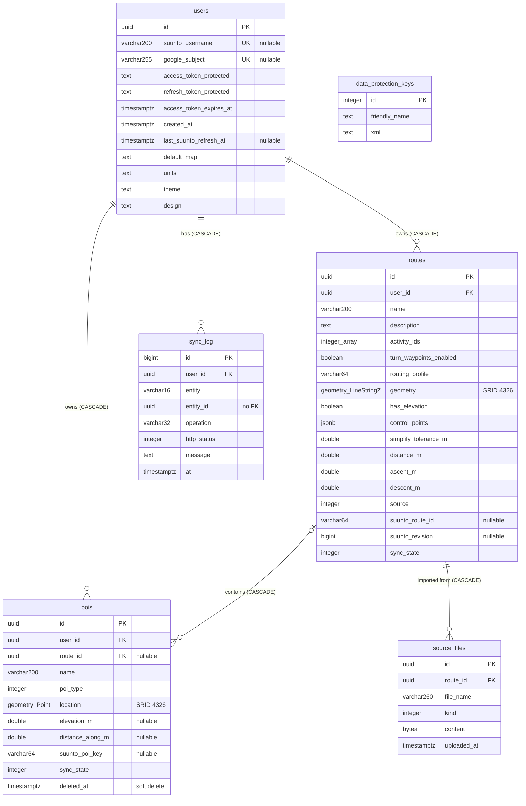

# Database documentation

Route POI Manager stores everything in a single **PostgreSQL 17 + PostGIS 3.5** database (`routepoi`). Access is through EF Core (`Npgsql.EntityFrameworkCore.PostgreSQL` 10 with NetTopologySuite). The schema is code-first: the source of truth is [`Entities.cs`](../src/RoutePoiManager.Domain/Entities.cs) and [`AppDbContext.cs`](../src/RoutePoiManager.Infrastructure/Persistence/AppDbContext.cs); the migrations live in [`Persistence/Migrations`](../src/RoutePoiManager.Infrastructure/Persistence/Migrations).

## Contents

1. [Overview](#1-overview)
2. [Entity-relationship diagram](#2-entity-relationship-diagram)
3. [Tables](#3-tables)
4. [Enumerations and lookup values](#4-enumerations-and-lookup-values)
5. [Relationships and delete behaviour](#5-relationships-and-delete-behaviour)
6. [Indexes and constraints](#6-indexes-and-constraints)
7. [JSON and spatial data](#7-json-and-spatial-data)
8. [Data lifecycle and business rules](#8-data-lifecycle-and-business-rules)
9. [Security and sensitive data](#9-security-and-sensitive-data)
10. [Migrations](#10-migrations)
11. [Operations](#11-operations)

---

## 1. Overview

| Item | Value |
|---|---|
| Engine | PostgreSQL 17 with the `postgis` extension (Docker image `postgis/postgis:17-3.5`) |
| ORM | EF Core 10, Npgsql provider, `UseNetTopologySuite()` |
| Naming | `snake_case` for tables, columns, keys and indexes (`UseSnakeCaseNamingConvention`) |
| Identity columns | `integer`/`bigint` identity (`GENERATED BY DEFAULT AS IDENTITY`) |
| Primary keys | `uuid` (app-generated, `Guid.CreateVersion7()`), except `sync_log` (`bigint`) and `data_protection_keys` (`integer`) |
| Time | All timestamps are `timestamp with time zone` (UTC in practice) |
| Coordinate system | WGS84, SRID **4326**, X = longitude, Y = latitude |
| Connection string | `ConnectionStrings:Db` (env: `ConnectionStrings__Db`) |
| Schema | `public` (default) |

Tables:

| Table | Purpose |
|---|---|
| `users` | App accounts, per-user settings and encrypted Suunto OAuth tokens |
| `routes` | Routes: computed line, drawing control points, stats and Suunto sync metadata |
| `pois` | Points of interest, either on a route or standalone (soft-deleted) |
| `source_files` | Original uploaded GPX/FIT file for each imported route |
| `sync_log` | Audit trail of Suunto sync operations |
| `data_protection_keys` | ASP.NET Core Data Protection key ring |
| `__EFMigrationsHistory` | EF Core migration bookkeeping |

Every row of user data (`routes`, `pois`, `sync_log`) carries `user_id`; all queries are scoped by it.

## 2. Entity-relationship diagram



`data_protection_keys` is standalone. `sync_log.entity_id` is deliberately **not** a foreign key (see [§3.5](#35-sync_log)).

## 3. Tables

Legend: **PK** primary key, **FK** foreign key, **UK** unique, **Null** = nullable. "Default" is the database default where one exists; otherwise the value is set by the application (the C# initialiser is shown in *Notes*).

### 3.1 `users`

One row per app account. An account is created either by Suunto OAuth sign-in (`suunto_username` set) or by Google sign-in (`google_subject` set). The two can be linked on one row, in which case the two accounts' data is merged (see [§8.4](#84-account-merge)).

| Column | Type | Null | Default | Description |
|---|---|---|---|---|
| `id` | `uuid` | no | | **PK** |
| `suunto_username` | `varchar(200)` | yes | | Suunto username (the `user` claim of the access token). **UK**. Null for Google-only accounts that have not connected Suunto |
| `google_subject` | `varchar(255)` | yes | | Stable Google `sub` identifier. **UK**. Null for Suunto-only accounts |
| `access_token_protected` | `text` | no | | Suunto access token, encrypted with ASP.NET Data Protection. Empty string `''` when not connected |
| `refresh_token_protected` | `text` | no | | Suunto refresh token, encrypted. Empty string `''` when not connected |
| `access_token_expires_at` | `timestamptz` | no | | Access token expiry. `DateTimeOffset.MinValue` when disconnected |
| `created_at` | `timestamptz` | no | | Account creation time |
| `last_suunto_refresh_at` | `timestamptz` | yes | | Last successful "Refresh from Suunto" |
| `default_map` | `text` | no | `'topo'` | Preferred base map layer in the editor |
| `units` | `text` | no | `'metric'` | Display units (`metric`/`imperial`) |
| `theme` | `text` | no | `'dark'` | Colour theme (`dark`/`light`) |
| `design` | `text` | no | `'classic'` | Visual design (`classic`/`alpine`/`soft`); independent of `theme` |

Notes:
- A user is "connected to Suunto" when `refresh_token_protected <> ''`. Disconnecting blanks the three token columns but keeps the user, routes and POIs.
- Setting columns (`default_map`, `units`, `theme`, `design`) are free `text`; allowed values are validated in the API (`UserSettingsEndpoints`), not by a DB constraint.

### 3.2 `routes`

A route the user drew in the editor, imported from a file, or pulled from Suunto.

| Column | Type | Null | Default | Description |
|---|---|---|---|---|
| `id` | `uuid` | no | | **PK** |
| `user_id` | `uuid` | no | | **FK** → `users.id` (CASCADE) |
| `name` | `varchar(200)` | no | | Route name |
| `description` | `text` | yes | | Free text |
| `activity_ids` | `integer[]` | no | | Suunto activity IDs the route is for (see [§4.3](#43-activity-types)). Initial value `{11}` (Hiking) |
| `turn_waypoints_enabled` | `boolean` | no | | Whether Suunto generates turn-by-turn waypoints on push |
| `routing_profile` | `varchar(64)` | no | | BRouter profile used when snapping segments (default from `RoutingProfiles.Default`) |
| `geometry` | `geometry(LineStringZ,4326)` | yes | | Full computed line; Z = elevation in metres. Null for a route with no line yet |
| `has_elevation` | `boolean` | no | `false` | `false` means Z values in `geometry` are placeholders (0) |
| `control_points` | `jsonb` | no | | The points the user placed, plus cached segments. See [§7.1](#71-routescontrol_points-jsonb) |
| `simplify_tolerance_m` | `double precision` | no | | Simplification tolerance (m) applied when pushing to Suunto. Initial value `5` |
| `distance_m` | `double precision` | no | | Total length in metres |
| `ascent_m` | `double precision` | no | | Total ascent in metres |
| `descent_m` | `double precision` | no | | Total descent in metres |
| `source` | `integer` | no | | Origin of the route: `RouteSource` enum ([§4.2](#42-routesource)) |
| `suunto_route_id` | `varchar(64)` | yes | | Suunto's route ID once pushed or pulled |
| `suunto_revision` | `bigint` | yes | | Suunto revision (epoch ms) last seen/pushed |
| `suunto_modified_at` | `timestamptz` | yes | | Suunto's modified time for the route as last seen |
| `last_pushed_hash` | `text` | yes | | Hash of the content at last push; used to detect local edits |
| `last_pushed_at` | `timestamptz` | yes | | Time of last successful push |
| `sync_state` | `integer` | no | | `SyncState` enum ([§4.1](#41-syncstate)). Initial value `0` (LocalOnly) |
| `created_at` | `timestamptz` | no | | |
| `local_modified_at` | `timestamptz` | no | | Last local change; compared with `last_pushed_at` / `suunto_modified_at` |

### 3.3 `pois`

A point of interest. May belong to a route (`route_id` set) or be standalone (`route_id` null).

| Column | Type | Null | Default | Description |
|---|---|---|---|---|
| `id` | `uuid` | no | | **PK** |
| `user_id` | `uuid` | no | | **FK** → `users.id` (CASCADE) |
| `route_id` | `uuid` | yes | | **FK** → `routes.id` (CASCADE). Null for a standalone POI |
| `name` | `varchar(200)` | no | | |
| `description` | `text` | yes | | |
| `poi_type` | `integer` | no | | Suunto POI type ID ([§4.4](#44-poi-types)). Initial value `26` (POI) |
| `location` | `geometry(Point,4326)` | no | | 2D position (lon/lat). Elevation is kept separately |
| `elevation_m` | `double precision` | yes | | Metres above sea level; null when unknown |
| `distance_along_m` | `double precision` | yes | | Distance along the route in metres; set only when the POI sits on its route |
| `activity_id` | `integer` | yes | | Suunto activity ID the POI is associated with |
| `suunto_poi_key` | `varchar(64)` | yes | | Suunto's key for the POI once pushed or pulled |
| `suunto_modified_at` | `timestamptz` | yes | | Suunto's modified time as last seen |
| `last_pushed_hash` | `text` | yes | | Content hash at last push |
| `last_pushed_at` | `timestamptz` | yes | | |
| `sync_state` | `integer` | no | | `SyncState` enum. Initial value `0` |
| `created_at` | `timestamptz` | no | | |
| `local_modified_at` | `timestamptz` | no | | |
| `deleted_at` | `timestamptz` | yes | | **Soft delete** marker; see below |

**Soft delete.** `AppDbContext` registers a global query filter `deleted_at IS NULL` on `Poi`, so normal queries never see deleted POIs. Suunto's POI API has no delete call, so a deleted POI is kept as a tombstone: undoing a delete restores the row with its `suunto_poi_key` (no duplicate is created on Suunto at the next push), and refresh/merge logic uses `IgnoreQueryFilters()` to see tombstones. There is no purge job; tombstones are removed only through cascading deletes of their route or user.

### 3.4 `source_files`

The original upload for an imported route, stored so the route can be re-examined or re-derived.

| Column | Type | Null | Default | Description |
|---|---|---|---|---|
| `id` | `uuid` | no | | **PK** |
| `route_id` | `uuid` | no | | **FK** → `routes.id` (CASCADE) |
| `file_name` | `varchar(260)` | no | | Original file name (truncated to 260 chars) |
| `kind` | `integer` | no | | `RouteSource` of the file (`Gpx`, `FitCourse`, `FitActivity`) |
| `content` | `bytea` | no | | Raw file bytes. Maximum size is governed by `UploadOptions` |
| `uploaded_at` | `timestamptz` | no | | |

This table has no direct `user_id`; ownership is through `routes`. It is the only table holding large binary data, so it dominates database size.

### 3.5 `sync_log`

Append-only audit trail of operations against the Suunto API and of sync state transitions.

| Column | Type | Null | Default | Description |
|---|---|---|---|---|
| `id` | `bigint` | no | identity | **PK** |
| `user_id` | `uuid` | no | | **FK** → `users.id` (CASCADE) |
| `entity` | `varchar(16)` | no | | `route`, `poi` or `account` |
| `entity_id` | `uuid` | yes | | ID of the route/POI concerned; null for `account`. **No foreign key**, so log entries survive deletion of the entity |
| `operation` | `varchar(32)` | no | | See table below |
| `http_status` | `integer` | yes | | HTTP status from Suunto (or the status the app recorded for the event) |
| `message` | `text` | yes | | Suunto ID/key, error text or conflict reason; truncated to 1000 chars |
| `at` | `timestamptz` | no | | Event time |

Operations written by the app:

| `entity` | `operation` | Written when |
|---|---|---|
| `route` | `import` | A new route was pushed to Suunto (message = Suunto route ID) |
| `route` | `update` | An already-pushed route was updated on Suunto |
| `route` | `take_theirs` | The user resolved a conflict by taking Suunto's version |
| `route` | `conflict` | A conflict was detected (HTTP 409; message = reason) |
| `route` | `remote_deleted` | Refresh found the route gone on Suunto (404) |
| `poi` | `create` / `upsert` | A POI was pushed (message = Suunto POI key) |
| `poi` | `push` | A POI push failed (status/message from the error) |
| `poi` | `remote_deleted` | Refresh found the POI gone on Suunto (404) |
| `account` | `refresh` | "Refresh from Suunto" completed |

### 3.6 `data_protection_keys`

Standard ASP.NET Core Data Protection key store (`IDataProtectionKeyContext`). The application name is `RoutePoiManager`.

| Column | Type | Null | Description |
|---|---|---|---|
| `id` | `integer` | no | **PK**, identity |
| `friendly_name` | `text` | yes | Key identifier |
| `xml` | `text` | yes | Key material (XML) |

## 4. Enumerations and lookup values

Enums are stored as `integer`; there are **no lookup tables** and no `CHECK` constraints. The authoritative definitions are in `Entities.cs` and `Lookups.cs`.

### 4.1 `SyncState`

Used by `routes.sync_state` and `pois.sync_state`.

| Value | Name | Meaning |
|---|---|---|
| 0 | `LocalOnly` | Never pushed to Suunto |
| 1 | `Synced` | Local copy matches what was last pushed or pulled |
| 2 | `LocalChanges` | Edited locally since the last push |
| 3 | `RemoteNewer` | Changed in the Suunto app since the last sync; local copy untouched |
| 4 | `Conflict` | Changed on both sides; the user must pick a resolution |
| 5 | `Error` | The last push failed |

### 4.2 `RouteSource`

Used by `routes.source` and `source_files.kind`.

| Value | Name | Meaning |
|---|---|---|
| 0 | `Drawn` | Drawn in the editor |
| 1 | `Gpx` | Imported from a GPX file |
| 2 | `FitCourse` | Imported from a FIT course file |
| 3 | `FitActivity` | Imported from a FIT activity file |
| 4 | `Suunto` | Pulled from the Suunto account |

### 4.3 Activity types

`routes.activity_ids` (array) and `pois.activity_id` use Suunto's activity (sport) IDs from `Activities.pdf`. The full list (IDs 0–121, e.g. 0 Walking, 1 Running, 2 Cycling, 10 Mountain biking, 11 Hiking, 22 Trail running, 70 Trekking) is in `ActivityTypes.All`. A few (92 Swimrun, 93 Duathlon, 94 Aquathlon) are flagged `WatchSupported = false`. IDs are validated in the API with `ActivityTypes.IsValid`.

### 4.4 POI types

`pois.poi_type` uses the `PoiType` enum of Suunto's POI API (v2/poi). The full list is `PoiTypes.All` (−1 Unknown, 0 Building … 77 Campfire; the numbering has gaps, e.g. 48–63 are unused). Commonly used values:

| Value | Name | Value | Name |
|---|---|---|---|
| −1 | Unknown | 24 | End |
| 3 | Parking | 26 | POI (default) |
| 4 | Camp | 34 | Peak |
| 12 | Water | 73 | Danger |
| 23 | Begin | | |

Names are matched case-insensitively against GPX waypoint `type` strings on import; unknown strings become 26 (POI).

## 5. Relationships and delete behaviour

| Constraint | From → To | On delete |
|---|---|---|
| `fk_routes_users_user_id` | `routes.user_id` → `users.id` | CASCADE |
| `fk_pois_users_user_id` | `pois.user_id` → `users.id` | CASCADE |
| `fk_pois_routes_route_id` | `pois.route_id` → `routes.id` | CASCADE (nullable) |
| `fk_source_files_routes_route_id` | `source_files.route_id` → `routes.id` | CASCADE |
| `fk_sync_log_users_user_id` | `sync_log.user_id` → `users.id` | CASCADE |

Consequences:
- Deleting a user removes all their routes, POIs, source files and sync log.
- Deleting a route removes its POIs (including soft-deleted tombstones) and source file. Bulk route deletion uses `ExecuteDeleteAsync`, so it relies on the database cascade, not on EF change tracking.
- A standalone POI (`route_id IS NULL`) is independent of any route.
- `pois.user_id` and `routes.user_id` are not cross-checked in the database: a POI's `user_id` is expected to equal its route's `user_id`, which the application maintains.

## 6. Indexes and constraints

| Index | Table | Columns | Type | Purpose |
|---|---|---|---|---|
| `pk_users` | `users` | `id` | PK | |
| `ix_users_suunto_username` | `users` | `suunto_username` | Unique | One account per Suunto user (multiple NULLs allowed) |
| `ix_users_google_subject` | `users` | `google_subject` | Unique | One account per Google identity (multiple NULLs allowed) |
| `pk_routes` | `routes` | `id` | PK | |
| `ix_routes_user_id` | `routes` | `user_id` | B-tree | Library listing per user |
| `ix_routes_user_id_suunto_route_id` | `routes` | `user_id, suunto_route_id` | Unique, **partial** `WHERE suunto_route_id IS NOT NULL` | A Suunto route maps to at most one local route per user |
| `pk_pois` | `pois` | `id` | PK | |
| `ix_pois_user_id` | `pois` | `user_id` | B-tree | POI listing per user |
| `ix_pois_route_id` | `pois` | `route_id` | B-tree | POIs of a route (FK index) |
| `ix_pois_user_id_suunto_poi_key` | `pois` | `user_id, suunto_poi_key` | Unique, **partial** `WHERE suunto_poi_key IS NOT NULL` | A Suunto POI maps to at most one local POI per user |
| `pk_source_files` | `source_files` | `id` | PK | |
| `ix_source_files_route_id` | `source_files` | `route_id` | B-tree | |
| `pk_sync_log` | `sync_log` | `id` | PK | |
| `ix_sync_log_user_id_at` | `sync_log` | `user_id, at` | B-tree | Per-user chronological history |
| `pk_data_protection_keys` | `data_protection_keys` | `id` | PK | |

Notes:
- The partial unique indexes ignore soft-deleted state: a tombstoned POI still occupies its `(user_id, suunto_poi_key)`. That is intentional, since restoring the POI must reuse the key.
- There are **no spatial (GiST) indexes** on `routes.geometry` or `pois.location`. The application filters by user and never runs bounding-box or distance queries in SQL. Add a GiST index if that changes.
- There are no `CHECK` constraints; value validation (names, enum ranges, setting values) is done in the API layer.

## 7. JSON and spatial data

### 7.1 `routes.control_points` (jsonb)

Mapped as a plain `jsonb` column holding a JSON array, serialised by `System.Text.Json` with web defaults (camelCase) and enums as camelCase strings. EF's owned-JSON mapping is not used because segments are nested arrays.

Each element is a `ControlPoint`:

| Field | Type | Description |
|---|---|---|
| `lon` | number | Longitude of the point the user placed |
| `lat` | number | Latitude |
| `modeToNext` | `"snap"` \| `"freehand"` | How the segment to the next point is drawn: routed along paths by BRouter (`snap`) or a straight line (`freehand`) |
| `segment` | `[[lon, lat, ele\|null], …]` \| `null` | Cached computed line from this point to the next one. Reopening a route reuses it, so no re-routing or elevation fetch is needed. Null on the last point or when not yet computed |

Example:

```json
[
  { "lon": 24.9384, "lat": 60.1699, "modeToNext": "snap",
    "segment": [[24.9384, 60.1699, 12.4], [24.9391, 60.1702, 12.9], [24.9402, 60.1710, null]] },
  { "lon": 24.9402, "lat": 60.1710, "modeToNext": "freehand", "segment": null }
]
```

`routes.geometry` is the concatenation of the segments and is what is exported and pushed to Suunto; `control_points` is what is used to resume editing.

### 7.2 Geometry columns

| Column | PostGIS type | SRID | Notes |
|---|---|---|---|
| `routes.geometry` | `geometry(LineStringZ, 4326)` | 4326 | X = lon, Y = lat, Z = elevation (m). When `has_elevation = false`, Z is 0 |
| `pois.location` | `geometry(Point, 4326)` | 4326 | 2D. Elevation is in `elevation_m` (was Z before migration `PoiElevationSoftDelete`) |

Useful queries:

```sql
-- POIs within 500 m of a point (geography cast for metres)
SELECT name FROM pois
WHERE deleted_at IS NULL
  AND ST_DWithin(location::geography, ST_SetSRID(ST_MakePoint(24.94, 60.17), 4326)::geography, 500);

-- Route length in metres, recomputed from the geometry
SELECT name, distance_m, ST_Length(geometry::geography) AS computed_m FROM routes;

-- Per-user record counts
SELECT u.id, u.suunto_username, u.google_subject,
       (SELECT count(*) FROM routes r WHERE r.user_id = u.id) AS routes,
       (SELECT count(*) FROM pois p WHERE p.user_id = u.id AND p.deleted_at IS NULL) AS pois
FROM users u;
```

## 8. Data lifecycle and business rules

### 8.1 Creating data

- **Drawn route:** `source = 0`, `control_points` and `geometry` filled from the editor; `sync_state = 0`.
- **Import (GPX/FIT):** `ImportService` creates the `routes` row, a `pois` row per accepted waypoint (`distance_along_m` set when the waypoint lies on the line, `elevation_m` taken from the file or the nearest track point), and one `source_files` row, all in one `SaveChanges`.
- **Pull from Suunto:** `SuuntoRefreshService` inserts or updates routes (`source = 4`) and POIs keyed by `suunto_route_id` / `suunto_poi_key`.

### 8.2 Sync state machine

`sync_state` on routes and POIs is derived by comparing timestamps and hashes:

```
LocalOnly --push--> Synced --local edit--> LocalChanges --push--> Synced
                      |                         |
              remote change             remote change too
                      v                         v
                 RemoteNewer               Conflict --take theirs / force push--> Synced
                      
 any push failure --> Error
```

- `last_pushed_hash` is the content hash at the last push; a mismatch against the current content means local changes.
- `suunto_modified_at` / `suunto_revision` record Suunto's side. Suunto mixes epoch units (route revisions in ms, POI times in s); `SyncSupport.FromSuuntoTime` normalises them (values above 10¹¹ are read as ms).
- Suunto forbids polling, so remote changes are discovered only on an explicit **Refresh from Suunto**.
- A route or POI missing on Suunto (404) is logged as `remote_deleted`. The local row is kept but unlinked: its Suunto ID/key, revision and modified time are cleared and `sync_state` returns to `LocalOnly`, so the next push uploads it as new. Soft-deleted POIs are left alone.

### 8.3 Deleting data

- **Routes:** hard delete (cascade to POIs and source file).
- **POIs:** soft delete via `deleted_at` (single delete, bulk delete, and removal of a POI from a route's POI list all set it). Re-adding the same POI id clears `deleted_at`.
- **Disconnect from Suunto:** blanks the token columns only; no route/POI data is removed.

### 8.4 Account merge

Suunto and Google sign-ins create separate `users` rows. When a Google account connects Suunto (or vice versa) and the other row already exists, `SuuntoTokenService.MergeAccountDataAsync` moves data from the source user to the target user:

1. For routes that exist on both sides (same `suunto_route_id`), the source's route wins; the target's copy is removed, but its source files are re-pointed to the surviving route and POIs not already present (by `suunto_poi_key`) are re-parented.
2. Target POIs whose `suunto_poi_key` also exists on the source side are deleted (including tombstones).
3. All remaining source routes, all source POIs (tombstones included) and the source `sync_log` entries get `user_id = target`.

This is what the partial unique indexes protect: after the merge no user has two rows for the same Suunto key.

## 9. Security and sensitive data

| Data | Where | Protection |
|---|---|---|
| Suunto access and refresh tokens | `users.access_token_protected`, `users.refresh_token_protected` | Encrypted by ASP.NET Data Protection before being stored; the browser never sees them (backend-for-frontend design) |
| Data Protection keys | `data_protection_keys.xml` | Stored **unencrypted** in the database (no `ProtectKeysWith*` configured). Anyone with DB access can decrypt the tokens, so protect database access and backups accordingly |
| Google identity | `users.google_subject` | Opaque identifier only; no email or name is stored |
| Location data | `routes.geometry`, `pois.location`, `source_files.content` | Personal data (routes can reveal home/work). Not encrypted at rest at the application level |
| Sync log `message` | `sync_log.message` | Contains Suunto IDs and error text, truncated to 1000 chars; no tokens |

Operational points:
- **Never restore the database without `data_protection_keys`.** Without the key ring, every stored token becomes undecryptable and all users must reconnect Suunto.
- Default Docker credentials (`routepoi`/`routepoi`) are for local use; set `POSTGRES_PASSWORD` before the volume is first created in any shared environment. The container port is bound to `127.0.0.1` only.
- Tenant isolation is enforced in application queries (`WHERE user_id = …`); there is no PostgreSQL row-level security.

## 10. Migrations

Migrations are EF Core code-first, in `src/RoutePoiManager.Infrastructure/Persistence/Migrations`. Applied versions are tracked in `__EFMigrationsHistory`.

| Migration | Date (UTC) | Changes |
|---|---|---|
| `20261014125601_Initial` | 2026-10-14 | Creates `postgis`, `users`, `routes`, `pois`, `source_files`, `sync_log`, `data_protection_keys`, their keys, FKs and indexes |
| `20261014132111_RouteDrawing` | 2026-10-14 | `routes.has_elevation` (default `false`), `routes.control_points` (jsonb) |
| `20261014143753_PoiElevationSoftDelete` | 2026-10-14 | `pois.elevation_m`, `pois.deleted_at`; backfills `elevation_m` from the old Z value (`NULLIF(ST_Z(location),0)`); converts `pois.location` from `PointZ` to 2D `Point` |
| `20261016150000_GoogleAccounts` | 2026-10-16 | `users.google_subject` + unique index; `users.suunto_username` becomes nullable |
| `20261024193328_UserSettings` | 2026-10-24 | `users.default_map` (default `'topo'`), `users.units` (default `'metric'`) |
| `20261024194351_UserTheme` | 2026-10-24 | `users.theme` (default `'dark'`) |
| `20261024203327_UserDesign` | 2026-10-24 | `users.design` (default `'classic'`) |

Working with migrations (the repo pins the EF tool in `dotnet-tools.json`):

```bash
dotnet tool restore
dotnet ef migrations add <Name> \
  --project src/RoutePoiManager.Infrastructure --startup-project src/RoutePoiManager.Api
dotnet ef database update \
  --project src/RoutePoiManager.Infrastructure --startup-project src/RoutePoiManager.Api
```

Notes:
- `20261016150000_GoogleAccounts` has no `.Designer.cs`; it was written by hand with explicit `[DbContext]`/`[Migration]` attributes. The model snapshot (`AppDbContextModelSnapshot.cs`) is up to date.
- `PoiElevationSoftDelete` contains a lossy `Down` for POIs without elevation (Z is rebuilt as 0).
- New `NOT NULL` columns have been added with a `defaultValue`, so migrations are safe on populated tables.

## 11. Operations

### 11.1 Configuration

| Setting | Default | Meaning |
|---|---|---|
| `ConnectionStrings:Db` | `Host=localhost;Port=5432;Database=routepoi;Username=routepoi;Password=routepoi` | Npgsql connection string (required; startup fails without it) |
| `Database:MigrateOnStartup` | `true` | Runs `Database.MigrateAsync()` at API startup |
| `POSTGRES_PASSWORD` (compose) | `routepoi` | Database password; only effective before the data volume is first created |

### 11.2 Running locally

```bash
docker compose up -d db          # PostgreSQL 17 + PostGIS on 127.0.0.1:5432
```

Data lives in the named Docker volume `db-data`. The `postgis` extension is created by the first migration (the Docker image already ships it; a managed Postgres must allow `CREATE EXTENSION postgis`).

### 11.3 Backup and restore

```bash
# backup (custom format, includes data_protection_keys)
docker compose exec db pg_dump -U routepoi -Fc routepoi > routepoi.dump

# restore into an empty database
docker compose exec -T db pg_restore -U routepoi -d routepoi --clean --if-exists < routepoi.dump
```

Back up the whole database, not individual tables: tokens are only readable with the matching `data_protection_keys`.

### 11.4 Capacity and maintenance

- `source_files.content` (bytea) is the main driver of size. Postgres stores large values out-of-line (TOAST), so it does not slow queries on other columns, but it does grow backups.
- `sync_log` and POI tombstones grow without bound; there is no retention job. If needed, periodically delete old log rows (`DELETE FROM sync_log WHERE at < now() - interval '1 year'`) and, for POIs whose `suunto_poi_key IS NULL`, hard-delete old tombstones (those never reached Suunto, so there is no key to preserve).
- No other background cleanup runs against the database.

### 11.5 Conventions when changing the schema

1. Change `Entities.cs` / `AppDbContext.cs`, then add a migration; never edit applied migrations.
2. Keep `snake_case` names (generated automatically).
3. Add new `NOT NULL` columns with a default so existing rows migrate cleanly.
4. If a new table holds user data, give it `user_id` with a cascading FK to `users` so account deletion and account merge stay complete, and update `MergeAccountDataAsync` if it needs to move with the user.
5. Update this document.
