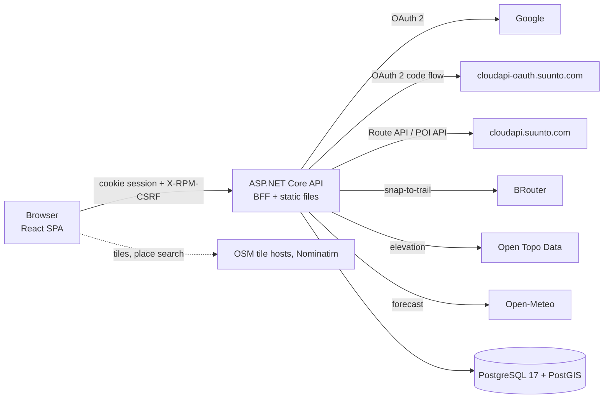
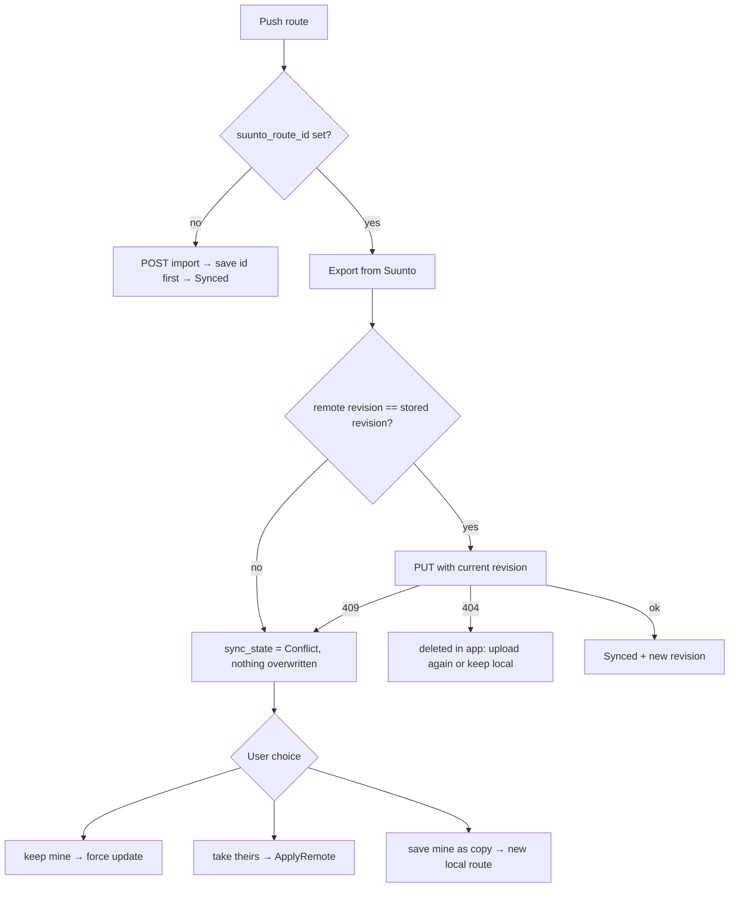

# Technical documentation

Route & POI Manager for Suunto: a web app to draw or import routes, place POIs, and push both to a Suunto account. This document describes how it is built. For features and setup see the [README](../README.md), for design history [PLAN.md](../PLAN.md), for the schema [database.md](database.md).

## Contents

1. [Architecture](#1-architecture)
2. [Solution layout](#2-solution-layout)
3. [Backend](#3-backend)
4. [Authentication and sessions](#4-authentication-and-sessions)
5. [HTTP API reference](#5-http-api-reference)
6. [Core domain logic](#6-core-domain-logic)
7. [Suunto integration and sync](#7-suunto-integration-and-sync)
8. [External services](#8-external-services)
9. [Frontend](#9-frontend)
10. [Security model](#10-security-model)
11. [Configuration](#11-configuration)
12. [Build, run and deploy](#12-build-run-and-deploy)
13. [Testing](#13-testing)
14. [Error handling and observability](#14-error-handling-and-observability)
15. [Known limitations and open points](#15-known-limitations-and-open-points)

---

## 1. Architecture



Key properties:

- **Backend for frontend (BFF).** One ASP.NET Core process serves the REST API and the built SPA. The browser holds only an HttpOnly session cookie (`rpm.session`); Suunto tokens stay on the server, encrypted at rest.
- **Local first.** Routes and POIs live in the database. Nothing reaches Suunto until the user presses **Push**; changes made in the Suunto app arrive only on **Refresh from Suunto** (Suunto forbids polling).
- **Multi-user, single instance.** Every query is scoped by the signed-in user's id. In-memory caches and rate limits assume one API process.
- **Stateless import.** File upload is parsed on the server twice (preview, then save) with the same pipeline; no server-side upload session.

## 2. Solution layout

```
RoutePoiManager.slnx
src/
  RoutePoiManager.Api             Host: minimal-API endpoints, auth, hardening, static files
  RoutePoiManager.Domain          Entities, geometry, route drawing/splitting, lookups (no I/O)
  RoutePoiManager.Infrastructure  EF Core/PostGIS, Suunto clients, sync, import, routing, elevation, weather
  RoutePoiManager.MockSuunto      In-memory fake of the Suunto cloud (tests / e2e)
  web/                            React + Vite SPA
tests/
  RoutePoiManager.UnitTests
  RoutePoiManager.IntegrationTests
docker-compose.yml                db + api
docker-compose.e2e.yml            overlay: api talks to MockSuunto
```

Dependency direction: `Api → Infrastructure → Domain`. Domain has no dependency on EF or HTTP (it only uses NetTopologySuite types).

Stack: .NET 10 (SDK pinned in `global.json`), ASP.NET Core minimal APIs, EF Core 10 + Npgsql + NetTopologySuite, Garmin FIT SDK, Polly resilience (`Microsoft.Extensions.Http.Resilience`), Serilog. Frontend: React 19, TypeScript, Vite, Leaflet/react-leaflet, TanStack Query, Zustand + zundo.

## 3. Backend

### 3.1 Request pipeline

Order in `Program.cs`:

1. `UseHardening` – forwarded headers (optional), HSTS (optional), security headers and CSP
2. `LocalhostRedirectMiddleware` – while `App:PublicBaseUrl` is on localhost, GETs on a loopback IP (`127.0.0.1`, `[::1]`) are redirected to `localhost` on the same port, because Google and Suunto only accept the registered `localhost` redirect URIs and cookies are host-bound
3. OpenAPI + Swagger UI (**non-Production only**)
4. `UseExceptionHandler` (problem details; Suunto/sync exception handlers)
5. Serilog request logging
6. Default files + static files (the SPA)
7. `CsrfHeaderMiddleware`
8. Authentication → `UseRequestLimits` (rate limiter, after auth so limits are per user) → Authorization

Then: `/healthz`, endpoint groups, `/api/lookups/*`, catch-alls (`/api/**` and `/auth/**` → 404, never the SPA shell) and `MapFallbackToFile("index.html")` (anonymous, so the login page loads).

Authorization is **deny by default**: a fallback policy requires an authenticated user; a route is public only with `.AllowAnonymous()`.

### 3.2 Layers

| Area | Where | Responsibility |
|---|---|---|
| Endpoints | `Api/Routes/*`, `Api/Auth/*` | Map HTTP to services/EF; resolve `userId` from claims; validate input |
| Options | `Api/AppOptions.cs`, `Auth/AuthOptions.cs`, `Hardening.cs`, `Infrastructure/*Options` | Bound, validated at startup (`ValidateOnStart`) |
| Persistence | `Infrastructure/Persistence` | `AppDbContext`, migrations |
| Suunto | `Infrastructure/Suunto` | OAuth client, API client, token service (encrypt/refresh/merge), route GPX builder |
| Sync | `Infrastructure/Sync` | `RouteSyncService`, `PoiSyncService`, `SuuntoRefreshService`, `SyncSupport` |
| Import | `Infrastructure/Import` | GPX/FIT parsers, shaping, shrinker, GPX⇄FIT converter, `ImportService` |
| Geo services | `Infrastructure/Routing`, `Elevation`, `Weather` | BRouter, Open Topo Data, Open-Meteo providers with caching and gates |
| Domain | `Domain/*` | Entities, `Geo`, `RouteDrawing`, `RouteSplitting`, `ImportShaping`, `PoiBehaviour`, lookups |

Services are scoped; caches and concurrency gates (`ElevationRateGate`, `RoutingConcurrencyGate`, memory cache with `SizeLimit = 500_000`) are singletons.

### 3.3 Resilience for outbound HTTP

| Client | Timeout | Policy |
|---|---|---|
| Suunto OAuth | 20 s | No resilience handler: token exchange is single-use and not idempotent |
| Suunto API | 60 s (attempt 20 s, total 55 s) | Standard handler, **retries disabled for unsafe methods** so a retried route import / POI create cannot duplicate data on Suunto |
| Open Topo Data | 60 s (attempt 15 s, total 45 s) | Standard handler; one request/second gate |
| Open-Meteo | 15 s (attempt 8 s, total 25 s) | Standard handler |
| BRouter | 30 s | None: a slow route should fail fast to a straight segment |

## 4. Authentication and sessions

Two sign-in methods create app accounts (`users` rows), both ending in the same cookie session.

| Method | Flow |
|---|---|
| **Suunto** | `GET /auth/login` → Suunto authorize (OAuth 2 code flow, `state` required unless `App:RequireOAuthState=false`) → `GET /auth/callback` exchanges the code, reads the `user` claim from the access token, upserts the user, stores encrypted tokens, signs in |
| **Google** (optional, enabled when client id and secret are set) | `GET /auth/google` → Google → `/auth/google-callback`; `OnCreatingTicket` checks the allowlist **before** creating the account, then `GoogleAccountService.GetOrCreateAsync(subject)`. Result is delivered through a small popup page (`/auth/google-popup-complete`) that messages the SPA |
| **Connect Suunto** (from a Google account) | `GET /auth/connect` runs the Suunto flow and links it; if a separate Suunto-only account exists its data is merged into the Google account (see database.md §8.4) |

Session cookie `rpm.session`: HttpOnly, `SameSite=Lax`, `Secure` when the request is https, sliding expiration, lifetime `Auth:SessionLifetime` (default 60 days). The API never redirects to a login page: unauthenticated → `401`, forbidden → `403`.

**Revalidation.** Long-lived cookies are re-checked every `Auth:SessionRevalidationInterval` (default 5 min) by `SessionValidation`: the user must still exist and pass the allowlist, otherwise the session ends. This is how removing an account from `ALLOWED_*` takes effect.

**Allowlists.** `ALLOWED_GOOGLE_EMAILS` (verified emails only) and `ALLOWED_SUUNTO_USERNAMES`. Both empty = open sign-up. A Google account connecting Suunto needs no Suunto allowlist entry.

**Suunto token handling** (`SuuntoTokenService`): access and refresh tokens are encrypted with ASP.NET Data Protection (application name `RoutePoiManager`, keys persisted in `data_protection_keys`). Tokens last 24 h; they are refreshed when `expires_at − RefreshSkew` has passed. Errors map to `SuuntoReauthRequiredException` (401) or `SuuntoNotConnectedException` (409) via exception handlers. `POST /auth/disconnect` revokes at Suunto (best effort) and blanks the stored tokens.

## 5. HTTP API reference

All paths except those marked *public* require a session cookie. All non-GET/HEAD/OPTIONS requests under `/api` and `/auth` must carry the header `X-RPM-CSRF` (any value), else `400`. JSON enums are camelCase strings. In non-Production, the OpenAPI document is at `/openapi/v1.json` and Swagger UI at `/swagger`; use those for request/response schemas.

### Auth and account

| Method | Path | Notes |
|---|---|---|
| GET | `/auth/login` | *public.* Start Suunto sign-in |
| GET | `/auth/connect` | Start linking Suunto to the current account |
| GET | `/auth/callback` | *public.* Suunto OAuth callback |
| GET | `/auth/google` | *public.* Start Google sign-in (only if configured) |
| GET | `/auth/google-callback` | *public.* Google callback (handled by the auth handler) |
| GET | `/auth/google-popup-complete` | Popup completion page |
| POST | `/auth/logout` | *public.* Clears the cookie |
| POST | `/auth/disconnect` | Revoke and forget Suunto tokens |
| GET | `/api/me` | Display name, Suunto mode, `connected`, Google/Suunto linkage, Google email |
| GET / PUT | `/api/settings` | `defaultMap`, `units` (`metric`/`imperial`), `theme` (`dark`/`light`), `design` (`classic`/`alpine`/`soft`); validated, 400 with per-field errors |
| GET | `/healthz` | *public.* `200 {status:"ok"}` if the DB is reachable, else `503` |

### Routes and POIs

| Method | Path | Notes |
|---|---|---|
| GET | `/api/routes` | List the user's routes (summary) |
| POST | `/api/routes` | Create a route from the editor payload |
| GET | `/api/routes/{id}` | Full route with control points and POIs |
| PUT | `/api/routes/{id}` | Save: carries the **whole POI list**; the server applies the diff (add/update/soft-delete/restore) |
| DELETE | `/api/routes/{id}` | Hard delete (cascade) |
| POST | `/api/routes/delete` | Bulk delete (`ExecuteDeleteAsync`) |
| GET | `/api/routes/{id}/gpx` | Push GPX plus every POI as `<wpt>` |
| POST | `/api/routes/{id}/split` | Split into two routes (tail → `"<name> (part 2)"`); not undoable |
| GET | `/api/routes/{id}/weather` | 7-day forecast along the saved route |
| GET | `/api/pois` | All of the user's POIs (including standalone) |
| DELETE | `/api/pois/{poiId}` | Soft delete |
| POST | `/api/pois/delete` | Bulk soft delete |

### Sync with Suunto

| Method | Path | Notes |
|---|---|---|
| POST | `/api/routes/{id}/push` | Create or update the route on Suunto; may end in a conflict |
| POST | `/api/routes/{id}/resolve` | Resolve a conflict: keep mine / take theirs / save mine as a copy |
| POST | `/api/routes/{id}/pois/push` | Push the route's POIs; per-POI results |
| POST | `/api/pois/push` | Push selected POIs (standalone or any) |
| POST | `/api/suunto/refresh` | Pull routes and POIs from Suunto (manual only) |

### Import and file tools (multipart, `DisableAntiforgery`, size-limited)

| Method | Path | Notes |
|---|---|---|
| GET | `/api/imports/limits` | `{ maxFileBytes }` for the UI |
| POST | `/api/imports/preview` | Parse a GPX/FIT file; returns track, waypoints, suggested POI types. Nothing is stored |
| POST | `/api/imports` | Re-upload with the user's `options` (tolerance, selected waypoints/types); creates route, POIs and the `source_files` row |
| POST | `/api/imports/convert` | GPX ⇄ FIT conversion, returns the converted file |
| POST | `/api/imports/shrink` | Reduce points (`toleranceM`), returns the file |

### Geo helpers and lookups

| Method | Path | Notes |
|---|---|---|
| GET | `/api/routing/profiles` | The 8 BRouter profiles |
| POST | `/api/routing/segment` | Snap one segment (`422` if no trail within `Routing:MaxSnapDistanceM`; `503` router unavailable) |
| POST | `/api/elevation` | Elevation for up to 100 points |
| GET | `/api/lookups/poi-types` | Suunto POI types (without `Unknown`) |
| GET | `/api/lookups/activity-types` | Suunto activity types |

### Common status codes

`400` validation / missing CSRF header · `401` not signed in or Suunto re-auth needed · `403` forbidden · `404` not found (also used for other users' data) · `409` Suunto not connected, or sync conflict · `422` sync request that cannot proceed (`SyncException`), or no snappable route · `429` rate limited (`Retry-After: 60`; Suunto 429 is surfaced as `suunto_rate_limited`) · `503` upstream router unavailable.

## 6. Core domain logic

### 6.1 Route drawing model (`Domain/RouteDrawing.cs`)

A route is edited as an ordered list of **control points**. Each stores the user's raw click, the mode of the leg to the next point (`snap` or `freehand`), and a cached **segment** (the computed line, with elevation). The line is the concatenation of segments; legs meeting at a snapped/freehand join get a straight connector (joint tolerance 1 m, identical on client and server). On save, `routes.geometry` is rebuilt from the segments and `distance_m`, `ascent_m`, `descent_m` are recomputed.

- Opening a route never re-routes or re-fetches elevation; editing recomputes only the segments adjacent to the change.
- Freehand segments are sampled every 50 m so the elevation profile has detail.
- Ascent/descent use smoothing so DEM noise does not inflate totals. `Geo.cs` (server) and `geo.ts` (client) implement the same algorithm and must stay in sync.

### 6.2 Import pipeline (`ImportShaping`, `ImportService`)

1. Parse GPX (1.0/1.1; tracks, routes, waypoints, Suunto route-point extension) or FIT (courses with course points, activities with laps).
2. Simplify: 1 m base pass, then Douglas–Peucker at the chosen tolerance. The browser runs an identical algorithm so the preview point count equals what is saved.
3. Build control points: about 60 m spacing, at least one every 2 km, at most 300; each keeps the original detail as its freehand segment.
4. Waypoints → POIs with a suggested type (`PoiTypes.FromGpxType`). Waypoints farther than 200 m from the track get no `distance_along_m`. Elevation is taken from the file or the nearest track point; none is looked up on import.
5. Persist route, POIs and the original file in one `SaveChanges`.

### 6.3 POI placement

A POI within 200 m of the line is *on route*: it gets `distance_along_m` and takes the route's elevation there; farther away it is *off route* (can be a Suunto POI, not a route waypoint). The editor snaps clicks within 20 screen pixels (max 200 m). Distance along is recomputed by the server on every save.

### 6.4 Split and reverse

Split is a server action: the tail and its POIs (keeping their Suunto keys) move to a new route. Reverse is client-side: freehand legs are reversed in the segment cache; snapped legs are re-routed because one-way paths matter. Trim is client-side and undoable.

## 7. Suunto integration and sync

### 7.1 Suunto API facts the code relies on

- OAuth on `cloudapi-oauth.suunto.com`; Route and POI APIs on `cloudapi.suunto.com`. Every API call needs `Authorization: Bearer` **and** `Ocp-Apim-Subscription-Key`.
- Route import `POST /v2/route/import` answers `{"items":[{"id": …}]}`; if the id cannot be read, the client looks the route up by name among recently modified routes, and the id is saved before anything else can fail so a later push cannot duplicate.
- Route update `PUT /v2/route/{id}` needs the GPX from export carrying `suunto:id` and the **current** `suunto:revision`; stale → `409`.
- POI `creation`/`modified` must be **epoch milliseconds**. Seconds yield HTTP 200 with `errorCode: 4` and an empty key (no POI created), so the client treats any non-zero `errorCode` or empty key as failure.
- POI coordinates: `x` = longitude, `y` = latitude. There is no delete endpoint for routes or POIs.
- `Suunto:Mode` is `Live` or `Mock`; the E2E overlay points `Suunto:*BaseUrl` at MockSuunto.

### 7.2 Push GPX

`Suunto/RouteGpx` builds the route GPX: on-route POIs become `<rtept>` vertices at their spot on the line, carrying a `suunto:routePoint` (name/type/description), with no separate `<wpt>` (avoids double waypoints). The line is simplified at 2 m between POI anchors; ends and anchors are always kept.

### 7.3 Route push and conflicts (`RouteSyncService`)



Every outcome writes a `sync_log` row (see database.md §3.5).

### 7.4 POI push (`PoiSyncService`)

Each POI is pushed as a standalone Suunto POI (create, or upsert when it has a key). Results are per POI so the UI can show successes and offer Retry for failures. Failures set `sync_state = Error` and log `push`.

### 7.5 Refresh from Suunto (`SuuntoRefreshService`)

Manual only. Pulls POIs first, then routes.

- Local copies unchanged since last sync take Suunto's version; locally edited ones become conflicts.
- Routes new from Suunto reuse a pulled POI with the same name within 15 m for their waypoints; otherwise waypoints stay part of the route, not POIs.
- Soft-deleted POIs are matched by key and stay deleted.
- A linked route/POI missing remotely is **unlinked** (Suunto id/key cleared, `LocalOnly`) and logged `remote_deleted`.

### 7.6 Deleting

Suunto has no delete, so deletes are local only; a route still on Suunto can reappear on the next refresh. The UI says so.

## 8. External services

| Service | Used for | Where | Notes |
|---|---|---|---|
| Suunto Cloud API | Routes, POIs, OAuth | Server | Partner access required |
| Google OAuth | App sign-in | Server | Optional |
| BRouter | Snap-to-trail (8 profiles) | Server (`RoutingService`) | Caches results; concurrency gate; a snap farther than `MaxSnapDistanceM` (300 m) → 422 → client falls back to freehand for that leg without an undo step |
| Open Topo Data | Elevation (`mapzen` dataset, global) | Server (`ElevationService`) | ≤100 points per request, 1 req/s, cache on ~11 m grid; `Elevation:Provider=None` disables |
| Open-Meteo | 7-day forecast | Server (`RouteWeatherService`) | Sampled at route start, midpoint and end; cached 30 min; local time from the midpoint's time zone; non-commercial free tier; CC BY 4.0 attribution |
| OSM / OpenTopoMap / CyclOSM tiles | Base maps | Browser | Allowed in the CSP `img-src` |
| Nominatim | Place search | Browser | In the CSP `connect-src` |

All are fair-use public services; self-host BRouter and Open Topo Data for heavy or multi-user use.

## 9. Frontend

`src/web`: React 19 + TypeScript + Vite, CSS Modules, Leaflet. The production build is served by the API as static files; in development Vite (port 5173) proxies `/api` and `/auth` to the API on 5080.

### 9.1 Feature modules (`src/features`)

| Module | Contents |
|---|---|
| `auth` | Login page (Google popup / Suunto), `useMe` |
| `library` | Dashboard: summary tiles, search/filter/sort, Boxes/List/Map views (remembered per browser), multi-select and bulk actions |
| `editor` | `EditorPage`, `MapView`, `MapToolbar`, elevation profile, section analysis, location search, `store.ts` (Zustand + zundo undo/redo), `segments.ts`, `geo.ts`, manual save, keyboard shortcuts |
| `pois` | All-POIs page (list and map), `PoiCard`, type/icon mapping, placement/snapping |
| `import` | Import picker and dialog, live simplification preview (`simplify.ts`) |
| `gpxTools` | Merge, split, shrink, GPX⇄FIT convert (client-side merge/split/shrink logic with tests) |
| `sync` | Sync panel, conflict / push-result dialogs, `withSuunto()` loader wrapper |
| `weather` | Forecast panel |
| `profile` | Profile page, `userSettings.ts` |
| `routes` | Route API client |

### 9.2 State and data

- **Server state:** TanStack Query.
- **Editor state:** a Zustand store wrapped with zundo for undo/redo over every edit (points, POIs, mode changes, trim). A separate transient `useSectionStore` holds the section-analysis selection (distances along the line); it is cleared on any line change and never saved.
- **Saving:** routes are saved only on explicit **Save**; leaving with unsaved changes prompts. A new route is added to the library only after at least one point is placed and saved.
- **Suunto loaders:** every call that reaches Suunto runs through `withSuunto()`, which drives an app-wide progress indicator and names the operation in the connection chip.
- **Preferences:** loaded from `/api/settings`, applied as `data-theme` and `data-design` on the root; `public/theme-init.js` sets the theme before first paint (an external script so the CSP can forbid inline scripts). Designs (`classic`, `alpine`, `soft`) override CSS tokens in `styles/designs.css`; layouts are shared.

### 9.3 Leaflet notes

A marker's icon must never change while it is dragged: `setIcon()` replaces the element the drag is bound to and the drop is lost. Selection is a CSS class on the existing element, handlers are bound once, titles updated in place.

### 9.4 Accessibility and responsiveness

Skip link, keyboard support, reduced-motion support, bottom tab bar on phones. Automated axe scans in Playwright cover both themes.

## 10. Security model

| Concern | Mechanism |
|---|---|
| Authentication | Cookie session (HttpOnly, SameSite=Lax, Secure on https); Google and Suunto OAuth; deny-by-default authorization |
| Tenant isolation | Every query filters by `userId` from claims; other users' ids return `404` |
| CSRF | `SameSite=Lax` plus a required custom header `X-RPM-CSRF` on unsafe `/api` and `/auth` requests (a cross-site form cannot set it) |
| OAuth | `state` required by default; Suunto tokens never reach the browser |
| Secrets at rest | Tokens encrypted with Data Protection; **the key ring is stored unencrypted in the DB** |
| Headers | `X-Content-Type-Options: nosniff`, `X-Frame-Options: DENY`, `Referrer-Policy: strict-origin-when-cross-origin`, `Permissions-Policy` (camera, microphone, geolocation, payment off), CSP (not on `/auth`, Swagger, OpenAPI), optional HSTS (1 year) |
| Rate limiting | Fixed window per minute, in memory: `/auth` per client address (30), routing/elevation per caller (120), everything else per caller (600); caller = user id when signed in, else address. `429` + `Retry-After: 60` |
| Reverse proxy | `Hosting:ForwardedHeaders` trusts `X-Forwarded-For/Proto` only from `TrustedProxies` (empty = any sender: use only when the proxy is the sole way in) |
| Uploads | Size cap `Uploads:MaxFileSizeMb` (default 20, 1–500), multipart limit follows it; files are held in memory |
| API docs | Swagger/OpenAPI disabled in Production |

Not provided by the app: TLS termination, http→https redirect, row-level security in PostgreSQL, encryption of stored location data.

## 11. Configuration

Settings come from `appsettings.json`, `appsettings.{Environment}.json`, `appsettings.Local.json` (git-ignored, not loaded in the `Testing` environment) and environment variables (`__` for nesting). The README has the full variable and setting tables; the groups are:

| Section | Purpose |
|---|---|
| `ConnectionStrings:Db` | Npgsql connection string (required) |
| `Database:MigrateOnStartup` | Apply EF migrations at startup (default `true`) |
| `App` | `PublicBaseUrl`, `RequireOAuthState` |
| `Suunto` | `Mode`, `ClientId`, `ClientSecret`, `SubscriptionKey`, base URLs, `RedirectUri` (validated on start; missing credential aborts startup) |
| `Google` | `ClientId`, `ClientSecret` (optional) |
| `Auth` | `SessionLifetime`, `SessionRevalidationInterval`, allowlists |
| `Uploads` | `MaxFileSizeMb` |
| `Routing`, `Elevation` | Provider endpoints and limits |
| `Hosting` | Forwarded headers, trusted proxies, HSTS, CSP, rate limits |
| `Serilog` | Logging |

## 12. Build, run and deploy

**Docker (single machine):**

```bash
cp env.example .env      # fill Suunto (and optionally Google) credentials
docker compose up --build -d      # app on http://localhost:5080
```

The `api` image is built from `src/RoutePoiManager.Api/Dockerfile` (it also builds the SPA); it runs with `init: true` so a startup failure exits visibly. `db` is `postgis/postgis:17-3.5` with a health check, published on `127.0.0.1:5432` only; the API waits for it to be healthy. Port 5080 is likewise bound to `127.0.0.1`.

**Development with hot reload:**

```bash
docker compose up -d db
dotnet run --project src/RoutePoiManager.Api
npm --prefix src/web install && npm --prefix src/web run dev   # http://localhost:5173
```

Put secrets in `appsettings.Local.json` (template: `appsettings.Local.json.example`). Suunto must redirect to the registered `http://localhost:5080/auth/callback`; the session cookie works on both ports and the API then sends the user on to 5173. Do not run the `api` compose service at the same time (port clash).

**Hosting for others:** put a TLS reverse proxy in front, set `App__PublicBaseUrl`, `Suunto__RedirectUri`, update the redirect URIs at Suunto and Google, set `FORWARDED_HEADERS=true` (+ `TRUSTED_PROXIES`), then `HSTS=true`. Details in the README. Run **one** API instance.

**Health:** `GET /healthz`. **Database:** see database.md §11 for backup and restore; always back up `data_protection_keys` with the data.

## 13. Testing

| Suite | Location | Scope |
|---|---|---|
| .NET unit | `tests/RoutePoiManager.UnitTests` | Geometry, parsers, shaping, route drawing, GPX building, routing/elevation/weather services, OAuth client |
| .NET integration | `tests/RoutePoiManager.IntegrationTests` | Full API on a throwaway PostGIS (Testcontainers; Docker required) with MockSuunto: access control, Google/Suunto login and account link, routes, POIs, import, route tools, sync and conflicts, settings, weather, hardening |
| Web unit | `src/web/src/**/*.test.ts(x)` | Editor store/undo, geo, segments, dialogs, dashboard logic, GPX tools (Vitest + Testing Library) |
| E2E | `src/web/e2e` | Playwright against the full stack with MockSuunto: sign-in, editing, import, push, dashboard, axe scans |

```bash
dotnet test
npm --prefix src/web test
docker compose -f docker-compose.yml -f docker-compose.e2e.yml up --build -d
npm --prefix src/web run e2e
```

Tests never touch a real Suunto account. **MockSuunto** reproduces the documented OAuth/Route/POI contracts and the live API's undocumented behaviour (epoch-ms POI timestamps, `errorCode` 4 on seconds, revision conflicts). `MockSuuntoContractTests` guards it.

## 14. Error handling and observability

- **Problem details** for errors (`AddProblemDetails`); `SuuntoReauthExceptionHandler` maps re-auth/not-connected to 401/409 and Suunto errors to stable codes (e.g. `suunto_rate_limited`); `SyncExceptionHandler` maps `SyncException` to 422.
- **Logging:** Serilog to console, configured from `Serilog` settings, with request logging. `SUUNTO_DIAGNOSTICS=true` logs the shape of Suunto responses, never tokens or keys. Refused sign-ins and ended sessions are logged.
- **Audit:** the `sync_log` table records Suunto operations per user.
- **Frontend:** an error page for route errors and toasts for action failures; BRouter 503 offers Retry; routing 422 falls back to freehand with a notice.

## 15. Known limitations and open points

From the code and design:

1. **Single instance only.** Routing/elevation caches, the shared fair-use gates and the rate limiter are in process memory; replicas multiply load on public services and split rate-limit counters.
2. **Weather is not in the "external" rate-limit bucket.** `Hardening.ExternalPrefixes` lists `/api/weather`, but the endpoint is `/api/routes/{id}/weather`, so it falls under the general 600/min limit instead of the 120/min external one. Either add that path or correct the prefix.
3. **Data Protection keys are stored unencrypted** in `data_protection_keys`; database access implies token access. Consider `ProtectKeysWith*` for shared deployments.
4. **No deletion on Suunto:** local deletes can resurface after a refresh.
5. **No webhooks:** Suunto changes appear only on manual refresh.
6. **Partner access:** Suunto grants API access to organisations; personal use may be refused.
7. **Watch limits are undocumented** (max route points, name length); routes are simplified at 2 m before push.
8. **Retention:** `sync_log` and POI tombstones grow without a cleanup job.
9. **No spatial indexes** and no DB-level validation (CHECK constraints); fine at current query patterns.
10. **License:** none chosen yet (all rights reserved).
